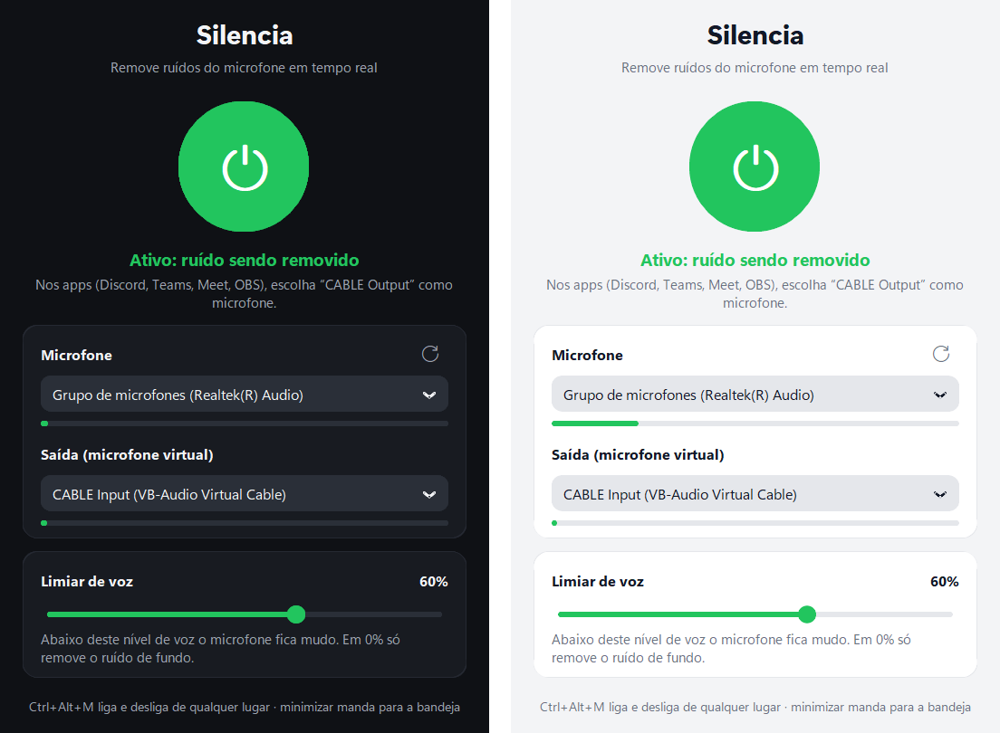

# Silencia

**Remove o ruído do seu microfone em tempo real, no Windows.** Ventilador, teclado, cachorro, obra na rua: quem está na chamada ouve só a sua voz.

É a mesma ideia do [NoiseTorch](https://github.com/noisetorch/NoiseTorch), que só existe para Linux. O Silencia usa a rede neural **RNNoise** e entrega o som limpo num microfone virtual, que você escolhe no Discord, Teams, Meet, Zoom ou OBS.

[](https://github.com/lpoletti/silencia/releases/latest)



## Recursos

- **Um botão só**: clique no botão redondo (ou aperte **Espaço**) para ligar e desligar o filtro.
- **Fica na bandeja**: minimize e o Silencia sai da barra de tarefas e vai para os ícones ocultos, perto do relógio. O ícone fica **verde ligado** e **cinza desligado**.
- **Atalho global Ctrl+Alt+M**: liga e desliga de qualquer programa, mesmo com o app escondido.
- **Supressão de ruído por IA**: RNNoise, a mesma rede neural do NoiseTorch, roda localmente; nada sai do seu PC.
- **Limiar de voz**: abaixo do nível escolhido o microfone fica mudo. Bom para teclado e ruídos curtos.
- **Instala o microfone virtual com um clique** e percebe sozinho quando a instalação termina.
- **Medidores de volume** da entrada e da saída, para ver o filtro trabalhando.
- **Segue o tema claro/escuro do Windows** e lembra suas escolhas da última vez.
- **Um único `.exe`**: não precisa instalar nem ter Python.

## Como usar

1. Baixe o `Silencia.exe` em [Releases](https://github.com/lpoletti/silencia/releases/latest) e abra.
2. Na primeira vez, clique em **Instalar** no aviso amarelo. Isso instala o [VB-CABLE](https://vb-audio.com/Cable/), um microfone virtual gratuito.
   No instalador, clique em **Install Driver**.
3. Escolha seu **Microfone** e clique no botão redondo. Verde = filtrando.
4. No app da chamada, escolha **CABLE Output** como microfone.

Pronto. Minimize o Silencia: ele fica nos ícones ocultos da bandeja (a setinha **^** ao lado do relógio) enquanto você está na chamada.

| Controle | O que faz |
|---|---|
| Botão redondo / Espaço | Liga e desliga o filtro (com a janela aberta) |
| **Ctrl+Alt+M** | Liga e desliga de qualquer programa, mesmo com o Silencia escondido |
| Ícone na bandeja | Verde = filtrando, cinza = desligado. Clique para abrir; botão direito para **Ligar**, **Desligar** ou **Sair** |
| Minimizar | Esconde a janela na bandeja (fechar no **X** encerra o app) |
| Microfone | Seu microfone de verdade (com ruído) |
| Saída | Para onde vai o som limpo: o **CABLE Input**. Para se ouvir e testar, escolha seus fones |
| Limiar de voz | Abaixo deste nível de voz o microfone fica mudo. Em 0% ele só tira o ruído de fundo |
| ⟳ | Procura de novo os aparelhos (depois de conectar um headset) |

Para já abrir filtrando, por exemplo num atalho na pasta Inicializar do Windows: `Silencia.exe --ativar`.

## Como funciona


O Silencia lê o microfone em blocos de 10 ms, passa cada bloco pela RNNoise e, se a probabilidade de voz estiver abaixo do limiar, silencia o bloco (com 200 ms de folga para não cortar o fim das palavras). O som limpo vai para o **CABLE Input**. O VB-CABLE entrega tudo o que entra ali no **CABLE Output**, que os outros apps enxergam como um microfone comum.

Medido num notebook, com voz real e alguém digitando: a voz passa inteira, o ruído de fundo cai cerca de 34 dB, as teclas cerca de 31 dB, e o atraso total fica em torno de 140 ms.

## Problemas comuns

**O PC ficou sem som depois de instalar o VB-CABLE.**
O instalador do VB-CABLE costuma mandar o som do Windows para o cabo. O Silencia percebe e mostra o aviso **"Seu PC ficou sem som"**: clique em **Corrigir**.

**O Windows diz que o app pode ser perigoso.**
O `.exe` não tem assinatura digital paga. Clique em **Mais informações → Executar assim mesmo**. Se preferir, rode direto pelo código (veja abaixo).

**O pessoal da chamada não me ouve.**
Confira se o Silencia está verde e se o app da chamada está com **CABLE Output** como microfone (não o seu microfone de verdade).

**Minha voz está cortando.**
Baixe o **Limiar de voz**. Em 0% o microfone nunca fica mudo e só o ruído de fundo é removido.

**O Ctrl+Alt+M não funciona.**
Outro programa já usa esse atalho; o rodapé da janela avisa quando isso acontece. Use o menu do ícone na bandeja.

**Quero o ícone sempre visível, fora dos ocultos.**
Arraste o ícone da área oculta (setinha **^**) para a barra de tarefas, ou ative o Silencia em **Configurações → Personalização → Barra de tarefas → Outros ícones da bandeja do sistema**.

## Para desenvolvedores

Requer Windows 10/11 e Python 3.12.

```bash
python -m venv .venv
.venv\Scripts\pip install -r requirements.txt
.venv\Scripts\python silencia.py      # roda o app
.venv\Scripts\python test_engine.py   # autoteste do motor, sem aparelho de áudio (inclui voz real gerada pelo Windows)
.venv\Scripts\python build.py         # gera dist\Silencia.exe
```

| Arquivo | O que tem |
|---|---|
| `engine.py` | Captura e reprodução (WASAPI), RNNoise + limiar de voz, fila entre os aparelhos, instalação do VB-CABLE e correção da saída padrão do Windows |
| `silencia.py` | Interface (CustomTkinter), ícone na bandeja e atalho global |
| `test_engine.py` | Autoteste: chiado, voz real com ruído, fila entre aparelhos |
| `build.py` | Gera o ícone e o `.exe` com PyInstaller |

## Créditos

- [RNNoise](https://github.com/xiph/rnnoise) (BSD-3-Clause), a rede neural de supressão de ruído, via a `rnnoise.dll` do [pyrnnoise](https://github.com/pengzhendong/pyrnnoise) (Apache-2.0)
- [CustomTkinter](https://github.com/TomSchimansky/CustomTkinter) (MIT), [python-sounddevice](https://github.com/spatialaudio/python-sounddevice) e PortAudio (MIT), NumPy (BSD)
- [pystray](https://github.com/moses-palmer/pystray) (LGPL-3.0), o ícone da bandeja, e [Pillow](https://github.com/python-pillow/Pillow) (MIT-CMU)
- [VB-CABLE](https://vb-audio.com/Cable/) (VB-Audio, donationware), baixado do site oficial na hora da instalação; não vem junto com o Silencia
- Ideia e comportamento inspirados no [NoiseTorch](https://github.com/noisetorch/NoiseTorch); nenhum código dele foi usado
